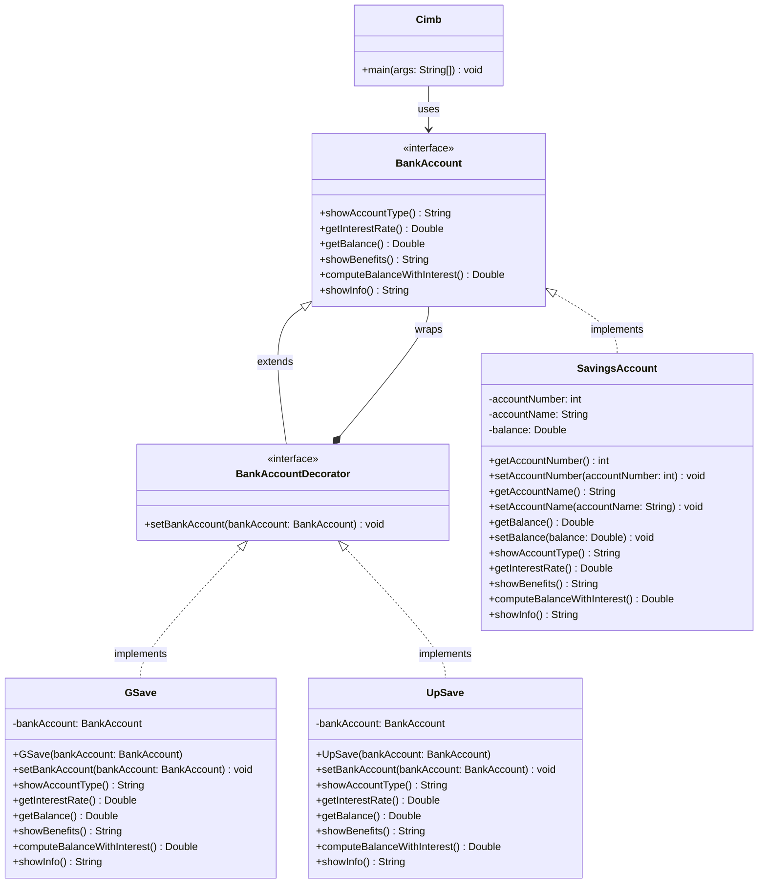

# CIMB Digital Bank - Decorator Pattern

## Problem Statement

CIMB is a digital bank that offers GSave and UpSave savings accounts. As with a typical Savings Account, it contains accountNumber, accountName, and a balance for that account.

The typical savings account offers an interest rate of 1%.
The benefits of the typical savings account is the same with the "Standard Savings Account" as compared to other banks.

The GSave account offers an interest rate of 2.5%.
Benefits include the "Standard Savings Account" plus access to "GCash transfer".

The UpSave account offers the highest interest rate of 4.0%.
Benefits include the "Standard Savings Account" plus "with Insurance".

Develop a decorator pattern approach that will implement the given UML diagram:

## UML Class Diagram

